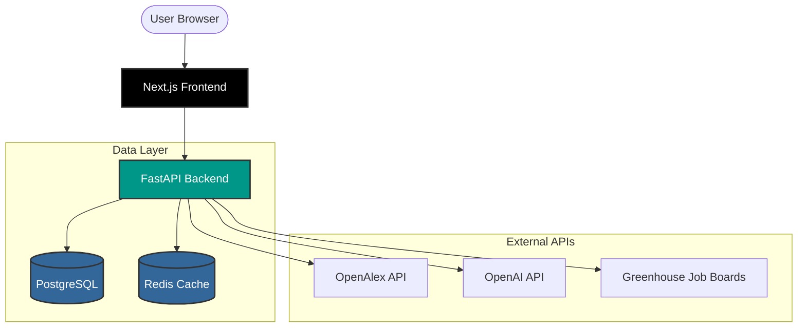

# Research Bridge AI


Research Bridge AI is a full-stack academic discovery and research-opportunity platform. It helps students navigate the complex academic landscape by discovering relevant papers, identifying suitable professors with deterministic evidence, and generating editable, evidence-grounded outreach drafts.

This project enforces strict **evidence before generation**, ensuring that LLMs are only used for text composition based on deterministic facts, never for inventing scores or retrieving non-existent papers.

---

## Architecture

The project is structured as a modular monolith built with a **Next.js** frontend and a **FastAPI** backend, backed by **PostgreSQL** (with pgvector) and **Redis**.



### Tech Stack

- **Frontend**: Next.js 14 App Router, React, TypeScript, Tailwind CSS, shadcn/ui, TanStack Query, React Hook Form, Zod.
- **Backend**: Python 3.12+, FastAPI, Pydantic, SQLAlchemy 2, Alembic, HTTPX, LangGraph.
- **Infrastructure**: Docker, PostgreSQL (pgvector), Redis.
- **Testing/Quality**: Playwright, Pytest, Ruff, Mypy, ESLint, axe-core.

---

## Core Features

- **Profile & Preference Tracking**: Persist research interests, past projects, and location preferences to surface the most relevant matches.
- **Deterministic Academic Discovery**: Query the OpenAlex API to find exact paper authors, normalized institutions, and verifiable topics.
- **Evidence-Grounded Recommendations**: Professor candidates are ranked based on a verifiable multi-factor heuristic (query evidence, profile alignment, supporting depth, recent activity), not LLM hallucination.
- **Safe Outreach Drafting**: Select specific papers and generate an outreach draft. The system maps generated claims to explicit source evidence, warning the user of any unsupported claims.
- **Verified Opportunities**: Aggregate academic opportunities directly from known greenhouse boards using an explicit allowlist to prevent SSRF and hallucination.
- **LangGraph Workflow Orchestration**: Complex multi-step reasoning is handled asynchronously with streaming updates, preserving the deterministic nature of intermediate steps.

---

## Local Development & Docker Deployment

Research Bridge AI supports a full local-production setup using Docker Compose.

### Requirements

- Docker Desktop (or equivalent engine)
- Node.js 24 (for local frontend development)
- `uv` (for local backend development)

### Running with Docker Compose (Production Preview)

1. Clone the repository.
2. Copy the example environment files:
   ```bash
   cp apps/web/.env.example apps/web/.env.local
   cp apps/api/.env.example apps/api/.env
   ```
3. Fill in `NEXT_PUBLIC_SUPABASE_URL` and `NEXT_PUBLIC_SUPABASE_ANON_KEY` in
   `apps/web/.env.local`, and the matching `SUPABASE_URL` in `apps/api/.env`.
   Preserve existing environment files; copy examples only if files are missing.
   The frontend reads public settings at build time through a BuildKit secret;
   the API reads its environment at runtime. Never put a service-role key in the frontend.
4. Boot the stack from the repository root:
   ```bash
   docker compose up --build -d
   ```
5. Access the frontend at `http://localhost:3000` and the API documentation at `http://localhost:8000/docs`.

Docker runs migrations automatically. PostgreSQL is published on `127.0.0.1:5433`
to avoid Windows PostgreSQL on port 5432; containers use `postgres:5432` internally.
Use `docker compose ps` to check status and `docker compose stop` to stop services
without deleting data. After changing frontend public configuration, use
`docker compose build --no-cache web` and then `docker compose up -d` because
BuildKit secret contents do not invalidate a cached build step.

### Running Locally (Development)

Start Docker infrastructure with `docker compose up -d postgres redis`. For a
host-run backend, set the port in `apps/api/.env`'s `DATABASE_URL` to `5433`.
Do not run the local backend/frontend and their containers on the same ports.


**Backend:**
```bash
cd apps/api
uv sync
uv run alembic upgrade head
uv run uvicorn app.main:app --reload --port 8000
```

**Frontend:**
```bash
cd apps/web
npm ci
npm run dev
```

---

## Documentation & Runbooks

- [Architecture & Rules](AGENTS.md)
- [Product Specification](PROJECT_SPEC.md)
- [Deployment & Incident Runbooks](docs/deployment.md)
- [Recruiter Interview Script](docs/recruiter-interview-script.md)
- [Learning & Development Log](docs/LEARNING_LOG.md)

## Limitations

- **Search Capabilities**: OpenSearch integration is deferred. PostgreSQL `tsvector` is used for basic full-text needs.
- **Email Delivery**: The platform explicitly does **not** send emails automatically. It only generates drafts for human review.
- **Data Completeness**: Job titles, contact addresses, and current funding status remain unknown if not explicitly verified by a supported API. The system prefers showing "Unclear" over guessing.

## License

Copyright 2026. All rights reserved.


## Direct university website scans

After signing in and completing your profile, open **Discover → University
websites**. Enter a topic, select 10, 20 or 30 papers, choose India/international/both, and scan.
The app fetches official HTML directly. OpenAlex paper affiliations select additional topic-relevant universities; ROR verifies their official domains before crawling.
Cancel keeps results already received. Each citation links to its university
source and publication, with a checked timestamp. Work-mode filters apply to
internship programs separately from papers; unspecified mode stays unknown.

Reviewed sources: OIST, KAUST, ISTA, IIT Gandhinagar, IIT Kanpur, IISc and EPFL. Their internship programs
are entry points, not guarantees of current openings or Indian-student preference.
Targets are maximum desired unique results, not promised result counts. Limits:
120 seconds, 40 attempted pages, depth 3, a 240-link pending queue, 2 MB per page,
minimum one second between requests to a host, and two simultaneous scans per
API process (one per account). Site rules or HTTP failures can reduce coverage.
No PDFs, browser-rendered lists, third-party embedded publication databases,
Google Scholar, or arbitrary user-supplied URLs are crawled.

Matching is lexical and has not yet been evaluated for Recall/MRR/nDCG. Citation
extraction supports DOI/arXiv links and standard publication metadata; many page
formats remain unsupported. DOI and arXiv identities are deduplicated, but an
unlinked preprint and DOI version can still be separate records. Website results
are retained in this browser tab, but are not yet saved to the database or used
for mentor ranking/outreach.


## Student research workspace

Discover offers university website scans and academic database search. **Find
Professors** groups returned research authors by shared paper and lets you choose
one person for evidence review and an editable outreach draft. Academic titles,
contacts, current openings and work modes remain unknown without evidence.

Queries, results, filters and selections survive section navigation. Active
searches keep running while you browse another section. Refresh restores received
results but interrupts unfinished requests; restart those explicitly. Cancel keeps
received evidence; Clear results removes that search. Storage is account-scoped
and limited to this browser tab, cleared on account switch/sign-out. It can include
profile-derived matching facts and guided draft text; it contains no credentials
or raw resume uploads. Disabled/full browser storage limits refresh recovery, but
in-memory navigation continues working.

Scans show elapsed time and received paper/page counts, with a maximum two-minute
budget. University coverage combines reviewed sources with up to six topic-relevant ROR-verified institutions per scan, not every university. Seasonal
programs and published papers do not establish current internship availability.
